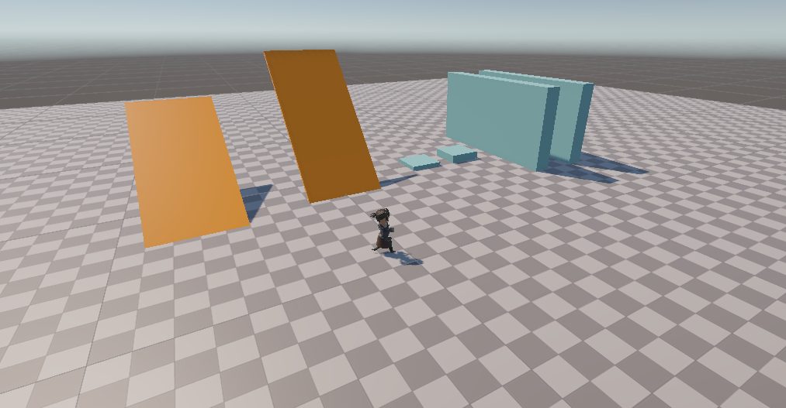
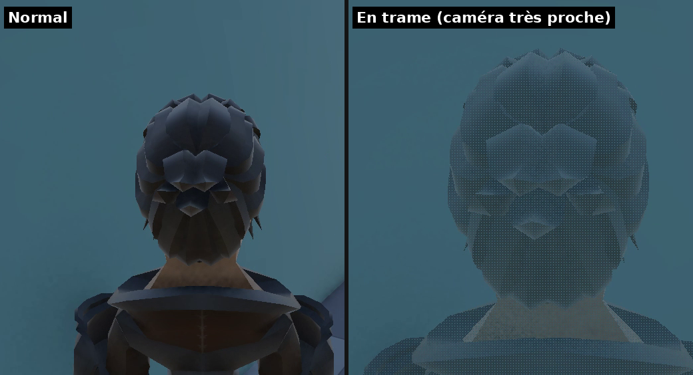

*Devlog du projet [SoloRealm (titre provisoire)](/blog_post/unity/SoloRealm.html).*

Premier jalon, et pas un seul monstre à l'écran. L'objectif était ailleurs : les **3C**, pour *Character, Camera, Controls*. Le personnage, la caméra et les contrôles. Dans un jeu qui veut donner la sensation d'un MMO, c'est ce qu'on touche en permanence, pendant des heures. Si ça ne sonne pas juste, aucun contenu ne rattrapera le reste.

Mon critère de fin était simple : **avoir envie de juste se balader avec le perso**, alors qu'il n'y a encore rien à faire.

---

## 1. Une scène de test avant tout

Avant de faire bouger quoi que ce soit, j'ai construit une **scène de test** qui sert de terrain d'essai pour tout le jalon :

- un **sol en damier**, où chaque case fait 1 m : on juge les vitesses à l'œil, sans rien mesurer ;
- une **pente douce** (30°) qu'on doit pouvoir monter, et une **pente raide** (50°) qui doit nous bloquer ;
- deux **escaliers** : des marches de 25 cm qui doivent passer, et de 50 cm qui doivent arrêter le perso ;
- des **murs**, un **couloir étroit** et un **plafond bas**, qui serviront surtout à tester la caméra.

Chaque type d'objet a sa couleur (gris pour les murs, orange pour les pentes), pour les repérer au premier coup d'œil. La scène est aussi rangée proprement dès le départ : le décor d'un côté, le joueur de l'autre, et la caméra à part, pour que le jour où le vrai décor arrive, rien ne soit à démêler.

<!--
  📷 IMAGE FIXE — SoloRealm_J1_SceneTest.png (800 px de large)
  À montrer : la Scene view (ou la Game view) en vue d'ensemble de haut, de 3/4, avec toute la scène
  de test visible : sol en damier, rampe orange 30° et 50°, les deux escaliers, les murs, le couloir
  et le plafond bas. Le perso visible au centre pour donner l'échelle.
  Pas de Hierarchy ni d'Inspector dans l'image (juste la vue 3D), pas de Gizmos de sélection.
-->

---

## 2. Des contrôles pensés en « actions »

Dans un MMO, chaque joueur a ses habitudes de touches. Les contrôles seront donc **personnalisables** dans les options (plus tard). Pour que ce soit facile à ajouter, le jeu ne parle jamais de touches mais d'**actions** : « Avancer », « Tourner », « Pas chassé », « Sauter »… La touche liée à chaque action n'est qu'un réglage.

Deux décisions prises dès ce jalon :

- **Les actions sont regroupées par contexte** : d'un côté tout ce qu'on fait dans le monde (se déplacer, tourner la caméra, et plus tard cibler et lancer des sorts), de l'autre les menus. Un seul contexte est actif à la fois : quand le menu pause est ouvert, appuyer sur « avancer » ne fait pas courir le perso derrière.
- **Les touches sont liées à leur position physique sur le clavier.** Mon clavier est en QWERTZ, et le schéma par défaut est W/A/S/D comme dans WoW. Un joueur en AZERTY aura automatiquement Z/Q/S/D, sans rien régler.

---

## 3. Le déplacement : le feeling de WoW

Le perso se déplace « à la MMO » : il **avance et recule** (le recul est plus lent, environ 60 % de la vitesse), **tourne** sur lui-même avec A et D, fait des **pas chassés** avec Q et E, et **saute**. Il **démarre et s'arrête instantanément**, sans inertie : c'est une des signatures de WoW, et c'est ce qui donne cette sensation de contrôle très précis.

Le perso monte les pentes et les marches raisonnables, et refuse celles qui sont trop raides ou trop hautes. La scène de test sert exactement à ça.

Le point sur lequel j'ai changé d'avis, c'est **le contrôle en l'air**. Au départ, j'étais parti sur un WoW « pur » : une fois le saut lancé, on ne peut plus corriger sa trajectoire. Fidèle, mais frustrant pour doser un saut sur un rebord. J'ai finalement choisi un **contrôle aérien limité**, comme dans le WoW moderne : on garde l'élan du saut, mais on peut le corriger doucement.

<!--
  🎬 VIDÉO MP4 — SoloRealm_J1_Deplacement.mp4 (8 à 12 secondes, sans son, elle tourne en boucle toute seule sur le site)
  À montrer : en Game view, caméra fixe un peu en hauteur derrière le perso :
  il avance, recule (on voit qu'il est plus lent), fait des pas chassés gauche/droite,
  monte la rampe douce, bute sur la rampe raide, monte les marches de 25 cm, bloque sur celles de 50 cm,
  puis saute d'une plateforme en corrigeant un peu son saut en l'air.
  Le damier doit bien se voir (il montre la vitesse).
-->
<video src="/image/SoloRealm_J1_Deplacement.mp4" autoplay loop muted playsinline width="800"></video>

---

## 4. La caméra orbitale

La caméra tourne autour du perso, comme dans tous les MMO :

- **Clic gauche maintenu** : on tourne la caméra autour du perso, sans le faire tourner, pour regarder autour de soi. Le curseur disparaît pendant qu'on tourne.
- **Molette** : on zoome et on dézoome, jusqu'à la **vue à la première personne** quand on zoome à fond.
- **Recentrage automatique** : quand on se déplace sans tenir le clic gauche, la caméra revient doucement se placer dans le dos du perso. À l'arrêt, elle reste là où on l'a mise.

Ce recentrage, c'est un détail qu'on ne remarque pas quand il est bien fait, mais qui manque tout de suite quand il n'est pas là : sans lui, on passe son temps à replacer la caméra à la main.

<!--
  🎬 VIDÉO MP4 — SoloRealm_J1_Camera.mp4 (8 à 12 secondes, sans son, elle tourne en boucle toute seule sur le site)
  À montrer : le perso immobile, on fait le tour complet avec la caméra (clic gauche), puis on zoome
  à fond jusqu'à la première personne et on dézoome. Ensuite on se remet à avancer et on voit la caméra
  revenir doucement dans le dos du perso.
-->
<video src="/image/SoloRealm_J1_Camera.mp4" autoplay loop muted playsinline width="800"></video>

---

## 5. Une caméra qui ne traverse pas les murs

Une caméra orbitale a un ennemi : le décor. Si on recule contre un mur, la caméra finit dedans, et on ne voit plus rien. La mienne **se rapproche du perso** dès qu'un obstacle se met entre eux, au besoin jusqu'à la première personne, puis **reprend la distance de zoom choisie** dès que la voie est libre. Le couloir étroit et le plafond bas de la scène de test sont là pour ça.

Problème suivant : quand la caméra se colle au perso, on se retrouve avec sa tête en plein écran. Comme dans WoW, le perso **s'efface progressivement** en dessous d'environ 2 m, jusqu'à devenir invisible en première personne (son ombre reste, c'est un joli détail).

Pour l'effacer, je n'utilise pas de vraie transparence : sur un modèle complexe, elle crée des problèmes d'affichage (des morceaux du perso qui passent devant ou derrière les autres au mauvais moment). J'utilise un **fondu en trame** (*dithering*) : le perso reste opaque, mais on retire de plus en plus de pixels selon un motif régulier. À l'écran, ça donne l'impression d'un fondu, sans aucun souci de tri.

<!--
  🎬 VIDÉO MP4 — SoloRealm_J1_AntiMurs.mp4 (6 à 10 secondes, sans son, elle tourne en boucle toute seule sur le site)
  À montrer : caméra dézoomée, le perso entre dans le couloir étroit ou recule contre un mur :
  la caméra se rapproche au lieu de traverser le mur, et le perso s'efface en trame quand elle est tout près.
  Puis il ressort et la caméra reprend sa distance. Idéalement, passe aussi sous le plafond bas.
-->
<video src="/image/SoloRealm_J1_AntiMurs.mp4" autoplay loop muted playsinline width="800"></video>

<!--
  📷 IMAGE FIXE — SoloRealm_J1_Dithering.png (800 px de large)
  À montrer : un gros plan sur le perso à moitié effacé (caméra à environ 1 m), pour bien voir le motif
  de la trame. Si tu peux, assemble deux images côte à côte : perso normal à gauche, perso en trame à droite.
-->

---

## 6. Les contrôles complets façon WoW

Dernière brique des contrôles, celle que tout joueur de WoW a dans les doigts :

- **Clic droit maintenu** : on tourne la caméra **et** le perso la suit. A et D ne tournent plus le perso, ils deviennent des pas chassés.
- **Clic gauche + clic droit** : le perso avance tout seul, et on le dirige à la souris.

Le schéma par défaut, en QWERTZ :

| Action | Touche |
|---|---|
| Avancer / reculer | W / S |
| Tourner | A / D |
| Pas chassés | Q / E (et A / D avec le clic droit maintenu) |
| Sauter | Espace |
| Tourner la caméra | Clic gauche maintenu |
| Tourner caméra + perso | Clic droit maintenu |
| Avancer à la souris | Clic gauche + clic droit |
| Zoom | Molette |

<!--
  🎬 VIDÉO MP4 — SoloRealm_J1_DeuxClics.mp4 (8 à 12 secondes, sans son, elle tourne en boucle toute seule sur le site)
  À montrer : on maintient le clic droit et on tourne à la souris, le perso suit la caméra ;
  on appuie sur A/D et il fait des pas chassés au lieu de tourner. Puis les deux clics enfoncés :
  il avance tout seul et on le dirige à la souris en slalomant entre les murs.
  Si tu as un outil d'affichage des touches à l'écran (type « Keyviz » ou « Carnac »), active-le :
  on comprend bien mieux la vidéo en voyant les clics et les touches.
-->
<video src="/image/SoloRealm_J1_DeuxClics.mp4" autoplay loop muted playsinline width="800"></video>

---

## 7. Un vrai perso animé

Jusque-là, mon héros était une capsule avec un petit « nez » pour savoir où était l'avant. Pour finir le jalon, il a laissé sa place au **Warrior** du *RPG Character Pack* de **Quaternius** (licence CC0), animé avec des animations de **Mixamo**.

Quelques choix importants :

- **Un squelette standard (Humanoid).** Les mêmes animations pourront servir à tous les personnages humanoïdes du jeu, quel que soit le pack d'où ils viennent.
- **Des animations « sur place ».** Ce n'est pas l'animation qui fait avancer le perso, c'est le déplacement qui pilote l'animation. Le feeling reste exactement celui réglé aux étapes précédentes, et le perso ne glisse jamais hors de sa trajectoire.
- **Une course qui se mélange selon la direction** : en avant, en arrière, en pas chassés et en diagonale, les animations se fondent les unes dans les autres selon l'endroit où l'on va.
- **Un saut en trois temps** : l'impulsion, la chute (qui dure aussi longtemps que nécessaire) et la réception.
- **Un réglage automatique à l'import.** Chaque animation Mixamo demande la même série de réglages. Plutôt que de les refaire à la main pour chaque fichier, un petit outil d'éditeur les applique tout seul dès qu'une animation arrive dans le projet.

<!--
  🎬 VIDÉO MP4 — SoloRealm_J1_Animations.mp4 (10 à 15 secondes, sans son, elle tourne en boucle toute seule sur le site)
  À montrer : caméra de côté ou de 3/4, le Warrior qui passe par toutes les animations :
  idle, course avant, recul, pas chassés gauche et droite, une diagonale, puis un saut complet
  (impulsion, chute depuis une plateforme, réception) et il repart en courant.
-->
<video src="/image/SoloRealm_J1_Animations.mp4" autoplay loop muted playsinline width="800"></video>

---

## 8. Ce qui m'a fait galérer

**Des marches à l'envers.** Mes deux escaliers de test étaient inversés : celui censé faire 25 cm dépassait de 50 cm, et inversement. Résultat, le perso bloquait là où il devait passer, et je cherchais le problème dans le déplacement alors qu'il était dans le décor. Leçon : vérifier d'abord le terrain de test.

**Une touche liée à… une manette Android.** En configurant le recul, l'outil de capture de touche a enregistré un stick de manette au lieu de la touche S. Rien ne plantait, le perso ne reculait juste jamais.

**Des pieds qui patinent.** Les courses de Mixamo sont calées pour environ 3,5 à 4 m/s, et mon perso court à 7 m/s. Il faisait donc deux fois moins de pas qu'il aurait dû, et ses pieds glissaient sur le sol. La solution : accélérer la lecture de chaque animation jusqu'à ce que les pieds « accrochent » le damier.

**Un perso figé après un petit saut.** Sur un saut très court, ou en atterrissant sur une plateforme, le perso retouchait le sol avant que l'animation de chute ait eu le temps de démarrer. Il restait alors coincé dans la pose de l'impulsion, les bras écartés. Il a fallu prévoir un passage direct de l'impulsion à la réception.

**Une réception trop lente.** L'animation de réception commençait par quelques images où le perso s'enfonçait dans le sol avant de pouvoir repartir. Couper ces premières images a suffi à rendre l'atterrissage plus vif.

---

## 9. Les « ah ouais d'accord » du jalon

**Les 3C, c'est du ressenti avant d'être de la technique.** Chaque valeur (vitesse, vitesse de recul, rotation, hauteur de saut) se règle manette en main… enfin, souris en main. C'est pour ça qu'elles sont toutes réglables directement dans l'éditeur.

**La caméra fait la moitié du feeling.** Le recentrage automatique, l'anti-murs, le fondu du perso : aucun n'est spectaculaire seul, mais sans eux, le jeu semble immédiatement « amateur ».

**Le visuel et la logique doivent rester séparés.** Remplacer la capsule par le Warrior n'a rien cassé, parce que dès le départ, le modèle 3D n'était qu'un habillage posé sur le vrai joueur.

---

## 10. Ce que je n'ai pas fait

- Le **menu de personnalisation des touches** : le jeu est prêt pour ça, mais le menu viendra plus tard.
- Les **options de caméra** (inverser l'axe vertical, sensibilité).
- Le **polish des animations** : les pieds qui s'adaptent aux pentes et quelques transitions sur mesure. Je ne suis pas animateur, il reste de petits défauts, et c'est très bien comme ça pour un prototype.

---

## État à la fin du jalon

Un perso animé qui se déplace, saute et gère les pentes avec le feeling d'un MMO, une caméra orbitale qui se recentre, ne traverse pas les murs et efface le perso en vue rapprochée, et les contrôles à la souris que tout joueur de WoW a dans les doigts. **Le Jalon 1 est terminé.**

Prochaine étape : **le combat**, avec un mannequin d'entraînement, le ciblage au Tab, la barre de sorts et les premiers ennemis.
