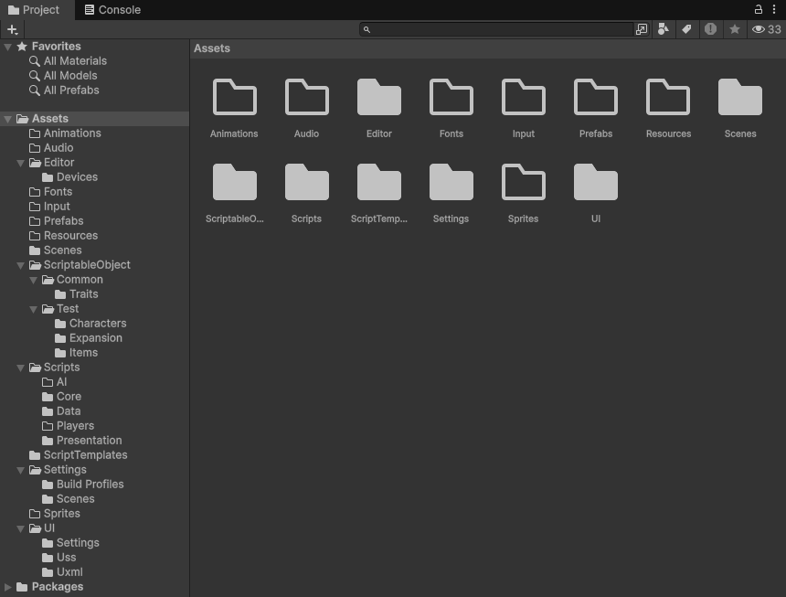
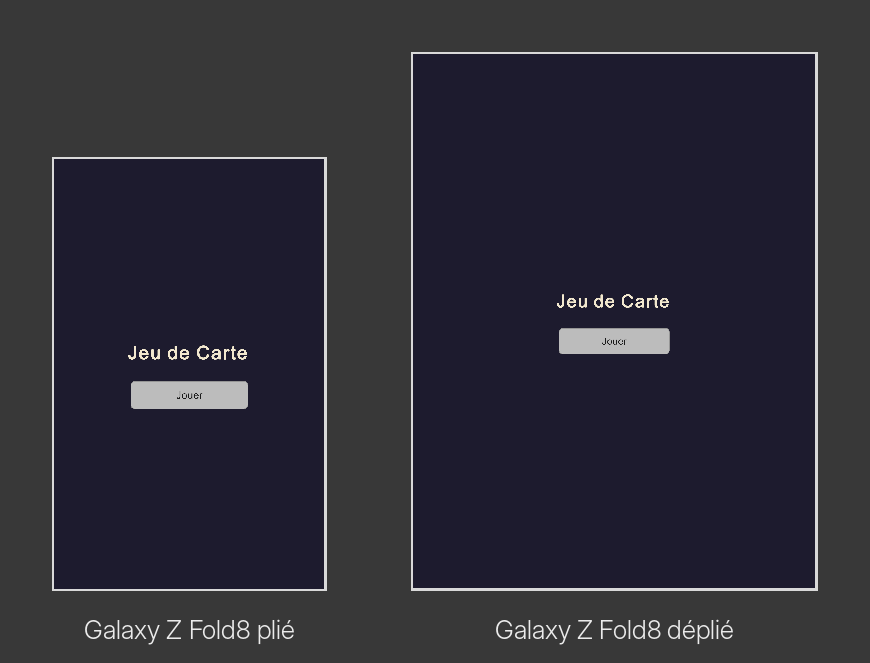

*Devlog du projet [Jeu de Carte (titre provisoire)](/blog_post/unity/Jeu_De_Carte.html).*

Premier jalon, et comme souvent, pas une seule carte à l'écran. L'objectif était ailleurs : avoir un projet propre qui tourne sur **Android et PC**, et surtout un écran qui s'adapte à **n'importe quel téléphone**, y compris un pliant qu'on ouvre et qu'on ferme en pleine partie. Pour un jeu de cartes où tout est de l'interface, c'est la fondation sur laquelle tout le reste va reposer.

---

## 1. Le projet et son rangement

Projet Unity 6 créé en **Universal 2D** (le rendu URP pour la 2D). Dès le premier jour, j'ai rangé les dossiers selon les trois couches du projet : **les règles**, **les joueurs** (humain et IA) et **l'affichage**. Les dossiers sont encore presque vides, mais la séparation est là : quand j'écrirai le moteur de règles, il n'aura physiquement pas sa place à côté de l'interface.

Côté identité, le projet est enregistré sous mon nom de studio, **Trijeux**, et versionné sur Git dès le premier commit.

---

## 2. Android et PC, deux cibles très différentes

**Sur Android**, le jeu doit accepter la **rotation automatique** (portrait et paysage) et la **fenêtre redimensionnable**. Ce deuxième réglage est indispensable sur un pliant : quand on ouvre le téléphone, l'application ne redémarre pas, c'est la même fenêtre qui change brutalement de taille et de proportions.

**Sur PC**, le jeu s'ouvre dans une fenêtre de **1280 × 800** que l'on peut redimensionner à volonté. Pas de résolution fixe : l'interface doit suivre.

---

## 3. Simuler un Galaxy Z Fold8 dans l'éditeur

Unity a un **Device Simulator** qui affiche le jeu comme sur un vrai téléphone (taille, encoche, densité de pixels). Le problème : mon téléphone, un Galaxy Z Fold8, n'était pas dans la liste. J'ai donc créé **deux profils sur mesure**, en vérifiant les caractéristiques réelles de l'appareil plutôt que de les inventer :

| Écran | Résolution | Densité |
|---|---|---|
| Plié (écran externe) | 1248 × 1972 | 428 dpi |
| Déplié (écran interne) | 1848 × 2448 | 403 dpi |

Avec ces deux profils, je peux passer d'un écran à l'autre en un clic dans l'éditeur, sans faire un build à chaque modification.

*Le même écran sur le Fold8 plié et déplié : le titre et le bouton gardent la même taille physique, c'est la place autour qui change.*

---

## 4. UI Toolkit et la taille physique

Toute l'interface est faite en **UI Toolkit**, le système d'interface de Unity qui ressemble au web : la structure de l'écran d'un côté, les styles de l'autre.

Le réglage clé de ce jalon, c'est l'**échelle de l'interface**. Le réflexe classique est de dire « mon interface est prévue pour 1080 × 1920 et Unity l'étire ». Sur un pliant, ça ne marche pas : l'écran plié et l'écran déplié n'ont ni la même taille ni les mêmes proportions, et un bouton étiré devient soit minuscule, soit énorme.

J'ai donc choisi la **taille physique** : l'interface est mesurée en **dp** (points indépendants de la densité), comme sur Android. Un bouton de 48 dp fait à peu près la même taille sous le doigt, que l'écran ait 400 ou 430 pixels par pouce. Résultat : sur le Fold déplié, on ne voit pas des boutons géants, on voit **plus de place**. Et pour un jeu qui doit afficher beaucoup de cartes, c'est exactement ce qu'on veut.

---

## 5. La safe area : l'encoche et le pli

Les téléphones modernes ont des zones où il ne faut rien afficher d'important : l'encoche de la caméra, les coins arrondis, la barre de navigation. Android donne cette zone « sûre » (la **safe area**), et l'écran s'y adapte maintenant automatiquement : les marges se recalculent quand on tourne le téléphone, et quand on le plie ou le déplie.

<video src="/image/Jeu_De_Carte_J1_SafeArea.mp4" autoplay loop muted playsinline width="800"></video>

*Le cadre jaune, c'est la safe area affichée par le Device Simulator : quelle que soit l'orientation ou l'écran, le contenu reste dedans.*

---

## 6. Un style « grand écran »

Dernier ajout : au-delà de **600 dp de large** (le Fold déplié, une tablette, une fenêtre PC), l'écran bascule sur un **style grand écran**. Pour l'instant, la différence ne se voit presque pas à l'écran (il n'y a qu'un titre et un bouton), mais c'est la base dont j'aurai besoin plus tard : sur un grand écran, la grille de cartes pourra s'étaler sur plus de colonnes au lieu de simplement grossir.

---

## 7. Le test sur les vrais téléphones

Fin de jalon oblige : **build Android** installé sur mon Galaxy Z Fold8 et sur un téléphone classique. Sur le Fold : plié, déplié, en portrait et en paysage, et surtout **pliage et dépliage pendant que le jeu tourne**. Tout tient. C'est aussi ce premier build qui m'a fait ajuster quelques réglages du rendu URP pour Android.

Pour voir à quoi ressemble ce test sur les vrais téléphones, les vidéos sont dans le [devlog du Jalon 2](/blog_post/unity/jeu_de_carte/Jeu_De_Carte-J2.html#8-voir-les-données--lécran-daperçu), avec un écran plus parlant que ce premier titre + bouton.

---

## 8. Les « ah ouais d'accord » du jalon

**Un pliant, ce n'est pas deux téléphones.** C'est un seul téléphone dont l'écran change de taille en direct. L'application doit le vivre comme un redimensionnement de fenêtre, pas comme un redémarrage.

**Penser en dp, pas en pixels.** Une fois qu'on raisonne en taille physique, la question « comment ça rend sur tel écran ? » devient « combien de place j'ai ? ». C'est beaucoup plus simple.

**Le simulateur ne remplace pas le vrai téléphone.** Il fait gagner un temps énorme, mais seul le vrai appareil montre ce que ça donne sous le doigt.

---

## 9. Ce que je n'ai pas fait

Pas de carte, pas de menu, pas de son. Et un point noté pour plus tard : en **plein écran sur PC**, la taille physique rend l'interface trop petite (un écran de PC est loin des yeux). Je le traiterai au jalon des finitions.

---

## État à la fin du jalon

Un projet propre, rangé par couches, qui tourne sur **Android et PC**. Un écran en UI Toolkit qui s'adapte à la taille physique, à l'encoche, à la rotation et au pliage, testé sur deux vrais téléphones. Prochaine étape : **les données du jeu**, c'est-à-dire les cartes.

*Suite : [Jalon 2 — Des cartes sans thème](/blog_post/unity/jeu_de_carte/Jeu_De_Carte-J2.html)*
