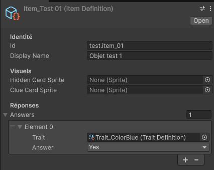
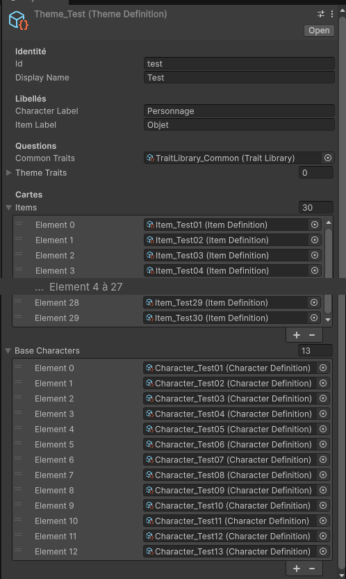

*Devlog du projet [Jeu de Carte (titre provisoire)](/blog_post/unity/Jeu_De_Carte.html).*

Deuxième jalon : **les données**. Avant de programmer les règles, il fallait décider ce qu'est une carte pour le jeu. Et avec une contrainte forte : le jeu doit pouvoir changer de thème (fantasy, espions…) sans qu'on touche au code. Il fallait donc des cartes qui ne savent pas à quoi elles ressemblent.

---

## 1. D'abord, les règles sur papier

Avant de créer la moindre donnée, j'ai repris la notice du jeu d'origine et je l'ai **traduite fidèlement** dans un document de design, en remplaçant les noms des cartes par un **vocabulaire neutre** :

- **Carte Personnage** : visible sur la table, le Maître en choisit une chaque tour.
- **Carte Objet** : cachée, dans la main des joueurs, c'est ce qu'il faut deviner.
- **Carte Indice** : une par objet, étalées face visible pour tout le monde.
- **OUI / NON / ?** : les trois réponses du Maître.

Ce vocabulaire a l'air anodin, mais c'est lui qui rend les thèmes possibles. Dans un thème fantasy, le Personnage sera un héros et l'Objet son arme. Dans un thème espions, un agent et son gadget. Le jeu, lui, ne parle que de Personnages et d'Objets.

Ce document liste aussi, à part, **les adaptations imposées par le numérique** (questions dans une liste, premier Maître au hasard), pour que chaque écart à la notice soit visible et justifié.

---

## 2. Une question, c'est une donnée

Sur table, on pose les questions qu'on veut. Dans le jeu, les questions sont **choisies dans une liste**, sinon une IA ne pourrait ni y répondre ni en poser.

Chaque question est donc une donnée, rangée dans une catégorie (couleur, matière, taille…). Et il y en a deux sortes :

- **Les questions communes**, partagées par tous les thèmes et formulées sans nommer l'objet : « Est-ce bleu ? ».
- **Les questions du thème**, propres à un univers : « Est-ce une arme tranchante ? » pour la fantasy, « A-t-il un silencieux ? » pour les espions.

La liste proposée au joueur, c'est les deux réunies. Chaque question a un **identifiant unique**, préfixé par sa provenance, pour qu'une question commune et une question de thème ne puissent jamais se confondre.

---

## 3. Un objet connaît ses réponses

Chaque **Objet** a un nom, le visuel de sa carte Objet et de sa carte Indice, et surtout **la bonne réponse à chaque question** : OUI, NON ou ?.

C'est ce qui permettra à une IA de jouer le Maître honnêtement : elle ne « réfléchit » pas à la réponse, elle la lit dans les données. Le **?** est réservé aux questions vraiment difficiles à trancher pour cet objet, exactement comme sur table.

*Un objet du thème de test dans l'éditeur : pas encore de visuels, et une seule question renseignée pour l'instant. Le vrai thème aura une réponse pour chaque question.*

---

## 4. Le thème : un paquet complet

Un **thème** rassemble tout ce qui fait un univers :

- les **libellés** affichés (par exemple « Héros » et « Arme » au lieu de « Personnage » et « Objet ») ;
- ses **questions propres** ;
- les **30 objets** ;
- les **personnages de base**.

Le nombre d'objets est fixe, parce que les règles en dépendent. Le nombre de personnages, lui, est plus libre : un thème doit en avoir **au moins 10**. Les personnages ne servent ni aux questions ni à la déduction, donc en changer le nombre ne touche pas aux règles.

Le thème **se vérifie lui-même** : s'il manque un objet, s'il y a trop peu de personnages, ou si deux éléments partagent le même identifiant, il le signale tout de suite dans l'éditeur. Une erreur de données se voit au moment où on la fait, pas au milieu d'une partie.

*Le thème de test dans l'éditeur (la liste des 30 objets est raccourcie au milieu).*

---

## 5. Les extensions : plus de personnages, rien d'autre

Le jeu d'origine a une extension qui ajoute des personnages. J'ai repris l'idée sous forme de **packs d'extension** rattachés à un thème.

Une extension **n'ajoute que des personnages**. Pas de questions : sinon il faudrait modifier les 30 objets du thème pour qu'ils y répondent. Pas de nouveaux objets non plus. Elle ajoute des cartes à la pioche Personnage, et c'est tout : les règles ne bougent pas.

L'intérêt, c'est que de nouveaux packs (des DLC, ou des récompenses à débloquer en jouant) pourront s'ajouter à un thème existant **sans toucher au thème ni au code**. Avant une partie, on choisira simplement les extensions actives.

---

## 6. Les règles ne verront jamais une image

Un choix d'architecture important de ce jalon : le futur **moteur de règles ne verra jamais ces données directement**. Il ne connaîtra que des identifiants et des réponses. Il saura que « l'objet n°12 répond OUI à la question couleur bleue », mais il ne saura pas que c'est une épée, ni à quoi elle ressemble.

C'est ce qui garde le moteur indépendant d'Unity (et donc testable seul, et un jour utilisable sur un serveur), et c'est ce qui rend le thème vraiment interchangeable.

---

## 7. Un thème de test généré automatiquement

Pour travailler, il me fallait un thème complet. Créer 30 objets et des dizaines de personnages à la main, avec les réponses à chaque question, aurait pris des heures et aurait été plein d'erreurs. J'ai donc fait un **outil dans l'éditeur** qui génère un thème de test complet en un clic : 30 objets avec leurs réponses, les personnages de base et une extension.

<video src="/image/Jeu_De_Carte_J2_Generateur.mp4" autoplay loop muted playsinline width="800"></video>

*Le menu de génération dans l'éditeur, puis le résultat : le dossier du thème de test avec ses objets, ses personnages et son extension.*

---

## 8. Voir les données : l'écran d'aperçu

Dernière étape : un **écran d'aperçu** qui affiche les 30 cartes Indice du thème. Ce n'est pas encore un écran de jeu, mais c'est le premier vrai test de mon pilier « lisible sur tous les écrans » : 30 cartes, c'est beaucoup, et elles doivent rester lisibles sur le Fold plié comme déplié.

Comme à chaque jalon, le **build Android** a été testé sur de vrais téléphones avant de clore. D'abord le Galaxy Z Fold8, plié, déplié et tourné pendant que le jeu tourne :

<video src="/image/Jeu_De_Carte_J2_Fold.mp4" autoplay loop muted playsinline width="400"></video>

Puis un téléphone classique, en portrait et en paysage :

<video src="/image/Jeu_De_Carte_J2_Telephone.mp4" autoplay loop muted playsinline width="400"></video>

*Vidéos filmées sur les vrais téléphones, avec le thème de test : les cartes sont encore des cartes vides, les visuels viendront plus tard.*

---

## 9. Les « ah ouais d'accord » du jalon

**Écrire les règles avant les données.** Traduire la notice d'abord m'a évité de créer des données inutiles, et m'a fait repérer des cas que la notice ne tranche pas (je les règlerai au jalon du moteur).

**Ce qui est fixe et ce qui est libre.** Les 30 objets sont fixes parce que les règles en dépendent. Les personnages sont libres parce qu'ils n'interviennent pas dans la déduction. Faire cette distinction a tout simplifié, notamment pour les extensions.

**Une donnée qui se vérifie elle-même.** Les erreurs de données sont les plus sournoises : tout compile, et le bug n'apparaît qu'en partie. Les attraper dans l'éditeur, c'est du temps gagné pour tous les jalons suivants.

---

## État à la fin du jalon

Les cartes existent, sans thème figé : des questions communes et propres au thème, des objets qui connaissent leurs réponses, des personnages, des thèmes qui se vérifient et des extensions prêtes pour de futurs packs. Un thème de test complet et un écran d'aperçu testé sur deux vrais téléphones. Prochaine étape, le cœur du jeu : **le moteur de règles et ses tests**.

*Précédent : [Jalon 1 — Un écran qui tient sur tous les téléphones](/blog_post/unity/jeu_de_carte/Jeu_De_Carte-J1.html)*
