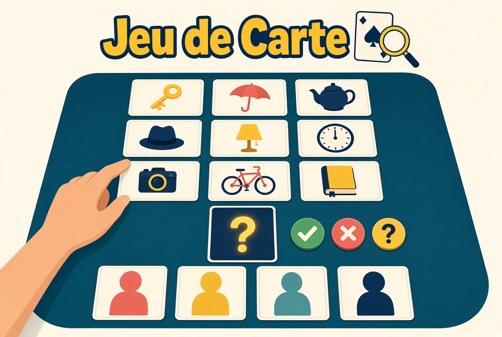
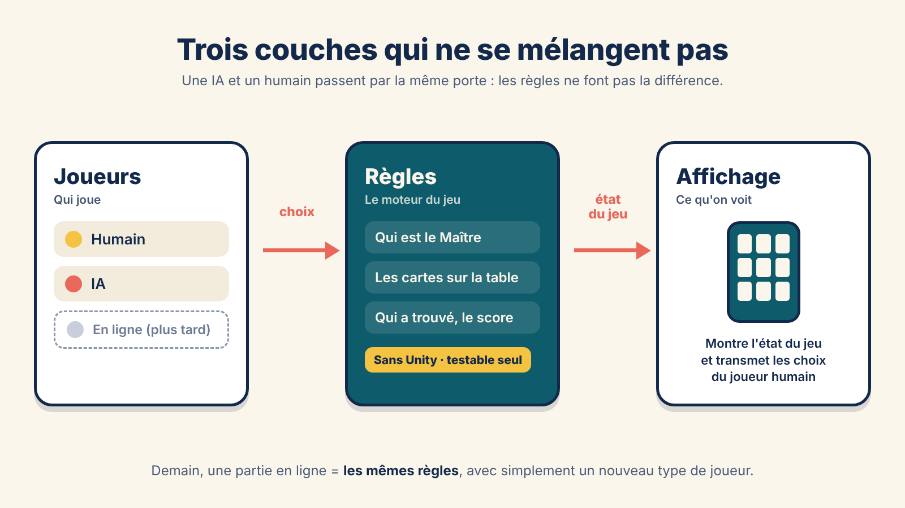

## Introduction

**Je vous présente mon nouveau projet perso : un jeu de cartes de déduction sur mobile et PC, fait sous Unity.** Le titre, *Jeu de Carte*, est provisoire : il changera quand le jeu aura trouvé son identité.

C'est l'adaptation numérique d'un jeu de cartes existant que j'aime beaucoup. Je m'impose une contrainte forte : **les règles restent strictement identiques à la notice d'origine**. Ce qui change, c'est tout le reste : le thème, les noms, les visuels et les textes sont originaux. Et ce thème n'est pas figé : le jeu est pensé pour en accueillir plusieurs (des héros fantasy et leurs armes, des espions et leurs gadgets…).

Le code, c'est moi qui l'écris. J'utilise Claude (l'IA d'Anthropic) comme prof et relecteur : il me guide étape par étape et relit mon code, mais il n'écrit pas le jeu à ma place.

*Concept art généré par IA pour illustrer l'idée du jeu : ce n'est pas une capture du jeu.*

---

## 1. Le principe du jeu

À chaque tour, un joueur devient le **Maître**. Il choisit en secret une association : un **Personnage**, visible de tous sur la table, et un **Objet**, caché, qu'il pose face contre table.

Les autres joueurs sont les **Enquêteurs**. Chacun leur tour, ils posent une question sur l'objet caché, et le Maître répond en secret avec une carte **OUI**, **NON** ou **?** (quand la question est trop difficile à trancher). Seul celui qui a posé la question voit la réponse.

Sur la table, toutes les **cartes Indice** sont étalées face visible : une par objet possible. Dès qu'un Enquêteur pense avoir trouvé, il prend la carte Indice correspondante. **Premier arrivé, premier servi** : une carte prise n'est plus disponible pour les autres. À la révélation, ceux qui ont vu juste marquent des points, et le Maître aussi s'il a été trouvé.

C'est un jeu court, malin, où il faut à la fois bien déduire et ne pas trop attendre. Le déroulement complet d'un tour est détaillé dans le [devlog du Jalon 3](/blog_post/unity/jeu_de_carte/Jeu_De_Carte-J3.html), celui du moteur de règles.

---

## 2. Les piliers du projet

Avant d'écrire la moindre ligne, je me suis fixé trois piliers. Chaque choix technique doit les respecter.

**1. Les règles de la notice, rien que les règles.**
Aucune règle n'est modifiée. Les seules adaptations permises sont celles imposées par le passage au numérique : les questions sont choisies dans une liste (pour que les IA puissent répondre et en poser), et le premier Maître est tiré au hasard. Chaque adaptation est notée et justifiée.

**2. Un thème interchangeable.**
Le jeu ne connaît que des « personnages », des « objets » et des « questions ». Les noms, les visuels et les textes viennent d'un **thème**, qu'on peut remplacer sans toucher au code. Un thème fantasy, un thème espions, un thème que je n'ai pas encore imaginé : c'est le même jeu.

**3. Lisible sur tous les écrans.**
Du petit téléphone au pliant déplié, jusqu'à la fenêtre PC, toutes les cartes Indice doivent rester lisibles et faciles à toucher. C'est la vraie difficulté d'un jeu de cartes sur mobile : beaucoup de cartes, peu de place.

---

## 3. Les plateformes

- **Android** : tous les téléphones courants, y compris les **pliants**. Mon téléphone est un Galaxy Z Fold8, donc chaque jalon est testé dessus, plié et déplié, et sur un téléphone classique.
- **PC (Windows)** : en fenêtre redimensionnable.

Le mode de jeu, pour commencer : **en solo contre des IA**. Le multijoueur en ligne viendra plus tard, avec **Android et PC dans la même partie**, et le projet est découpé dès le départ pour pouvoir l'ajouter sans tout réécrire.

---

## 4. L'architecture en trois couches

Pour que le multijoueur reste possible, le jeu est séparé en trois couches qui ne se mélangent pas :

- **Les règles** : le moteur du jeu, totalement indépendant d'Unity. Il sait qui est le Maître, quelles cartes sont sur la table, qui a gagné. Il ne sait pas à quoi ressemble une carte. Comme il est indépendant, je peux le tester seul, et un jour le faire tourner sur un serveur.
- **Les joueurs** : qui joue. Un humain, une IA, et plus tard un joueur à distance. Ils envoient leurs choix aux règles, jamais à l'affichage.
- **L'affichage** : l'interface, qui se contente de montrer l'état du jeu et de transmettre les choix du joueur humain.

L'avantage, c'est qu'une IA et un humain passent par exactement la même porte. Le moteur ne fait pas la différence, donc une partie à 4 IA, ou à 3 IA et un humain, ou demain à 4 humains en ligne, c'est le même code de règles.

---

## 5. La feuille de route

Le projet est découpé en **jalons**. Chaque jalon se termine obligatoirement par un **test en build Android sur deux vrais téléphones** (le Fold8, plié et déplié, et un téléphone classique) avant d'être clos.

| Jalon | Contenu | État |
|---|---|---|
| **1** | Projet et écran : Android, PC, pliants, interface de base | ✅ **Terminé** |
| **2** | Données : cartes, thèmes et extensions | ✅ **Terminé** |
| **3** | Moteur de règles et tests | ✅ **Terminé** |
| **4** | IA | ✅ **Terminé** |
| **5** | Écrans de jeu | 🔄 En cours |
| **6** | Partie complète | ⏳ À venir |
| **7** | Thème de test complet (pour tester sur téléphone, jamais publié) | ⏳ À venir |
| **8** | Extensions de thème : activation et désactivation | ⏳ À venir |
| **9** | Premier vrai thème : fantasy, avec ses extensions | ⏳ À venir |
| **10** | Game feel : feedback et animations | ⏳ À venir |
| **11** | Finitions et installation | ⏳ À venir |
| **12** | Multijoueur en ligne | 💤 Plus tard |

---

## 6. Stack technique

- **[Unity 6](https://unity.com/)**, projet 2D avec le rendu URP (Universal 2D)
- **UI Toolkit** pour toute l'interface : une approche proche du web (mise en page et styles séparés), bien adaptée à un jeu de cartes où presque tout est de l'interface
- **Device Simulator** de Unity, avec des profils sur mesure pour le Galaxy Z Fold8 plié et déplié
- **Git + GitHub** pour l'historique du projet

---

## 7. Et après ?

Quelques idées pour la suite, une fois le jeu jouable :

- **Publication sur itch.io**.
- **Des extensions à débloquer en jouant** : des packs de personnages inclus dans le jeu, gratuits, qui se débloquent avec des pièces gagnées en partie. Ils n'ajoutent que des cartes : les règles ne changent jamais.
- **Des visuels de cartes** : le chantier artistique viendra plus tard, une fois que le jeu tourne avec des cartes de test.

---

## Devlogs détaillés

Le retour d'expérience jalon par jalon : ce que j'ai fait, ce qui m'a fait galérer, ce que j'ai appris. Mis à jour à chaque jalon terminé.

- **[Jalon 1 — Un écran qui tient sur tous les téléphones (même pliés)](/blog_post/unity/jeu_de_carte/Jeu_De_Carte-J1.html)** — 02/11/2026
- **[Jalon 2 — Des cartes sans thème : les données du jeu](/blog_post/unity/jeu_de_carte/Jeu_De_Carte-J2.html)** — 03/11/2026
- **[Jalon 3 — Le moteur de règles, et mes premiers tests](/blog_post/unity/jeu_de_carte/Jeu_De_Carte-J3.html)** — 04/11/2026
- **[Jalon 4 — Des IA qui jouent sans tricher](/blog_post/unity/jeu_de_carte/Jeu_De_Carte-J4.html)** — 04/11/2026

---

## Conclusion

Ce projet, c'est un exercice de rigueur : garder des règles intouchables, tout en construisant un jeu assez souple pour changer de thème, d'écran et, un jour, de mode de jeu. Les quatre premiers jalons ont posé les fondations : l'écran, les données, le cœur du jeu (**le moteur de règles** et ses tests), puis **des IA** qui jouent sans tricher. Le prochain, ce sont **les écrans de jeu**, pour enfin voir les cartes sur la table. **À suivre !**
