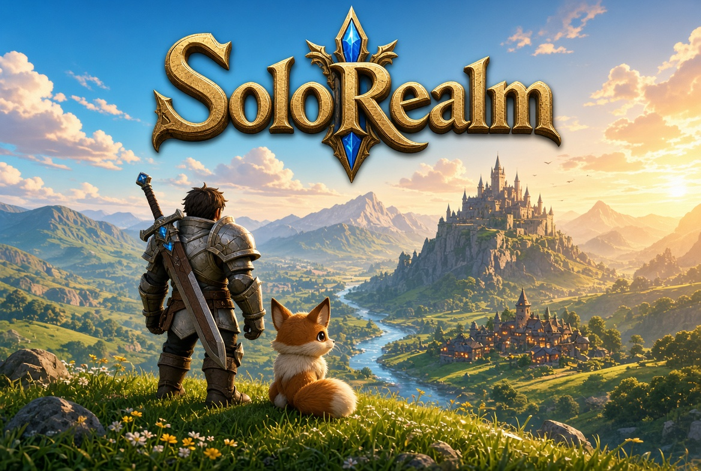
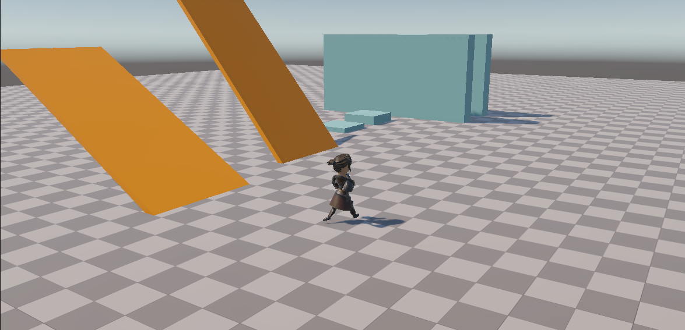
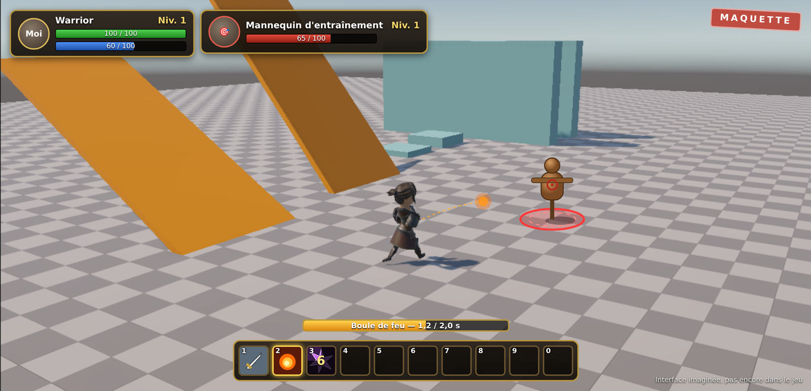

## Introduction

**Je vous présente mon nouveau projet perso : SoloRealm, un RPG solo en 3D fait sous Unity, dans l'esprit d'un MMORPG à l'ancienne… mais sans les autres joueurs.** Le titre est provisoire, il changera quand l'univers du jeu aura pris forme.

L'idée de départ est simple : retrouver les sensations de **World of Warcraft** et de **Final Fantasy XIV** (se balader dans un monde ouvert, enchaîner les quêtes, nettoyer un donjon, farmer *le* drop rare), mais tout seul, quand on veut, et sans connexion. La référence la plus proche, c'est **Afallon**, présenté sur Steam comme un « WoW solo ». Le but n'est pas de le copier, mais de partir de ce concept avec mon propre univers et mes propres choix de design.

Le code, c'est moi qui l'écris. J'utilise Claude (l'IA d'Anthropic) comme prof et relecteur : il m'explique, me guide étape par étape et relit mon code, mais il n'écrit pas le jeu à ma place. Les choix de design et de gameplay sont les miens.

<!--
  🖼️ ILLUSTRATION IA — SoloRealm_KeyArt.jpg (affichée en 800 px de large)
  À montrer : l'illustration « pub » générée par Grok (ambiance visée du jeu). Ce n'est PAS une capture :
  la légende juste en dessous le dit, ne la supprime pas.
-->

*Illustration d'ambiance générée par IA, pour montrer l'univers visé : ce n'est pas une capture du jeu. La vraie capture, c'est juste en dessous.*

<!--
  📷 IMAGE FIXE — SoloRealm_Cover.png (800 px de large environ)
  À montrer : la Game view en Play, caméra orbitale derrière le Warrior, vue de 3/4 dos,
  le perso en pleine course sur le sol en damier avec les rampes et l'escalier en arrière-plan.
  C'est la vraie capture, juste sous l'illustration IA : la plus propre possible, sans fenêtre d'éditeur autour
  (Game view en plein écran ou « Maximize On Play »), pas de Gizmos, pas de panneau Stats.
-->

*Où en est vraiment le jeu : le Warrior dans la scène de test, à la fin du Jalon 1.*

---

## 1. Le concept : un MMO, mais pour soi

Ce que j'aime dans un MMORPG, ce n'est pas forcément le côté multijoueur. C'est la prise en main au clavier et à la souris, la caméra qu'on tourne librement autour du perso, le combat où l'on sélectionne une cible avant de lancer ses sorts, et ce petit frisson quand un monstre lâche enfin l'objet rare qu'on farme depuis des heures.

SoloRealm veut garder tout ça, et retirer ce qui gêne quand on joue seul :

- **Pas d'abonnement, pas de serveur** : le jeu est **100 % hors ligne**, sur PC.
- **Pas de contenu qui exige un groupe** : les quêtes et les donjons sont pensés pour un seul joueur.
- **On joue à son rythme** : on peut lâcher le jeu une semaine, rien ne se passe sans nous.

---

## 2. Les piliers du projet

Avant d'écrire la moindre ligne, je me suis fixé quatre piliers. Quand j'hésite sur une décision, je reviens ici, et si une fonctionnalité ne sert aucun de ces piliers, elle passe en dernier.

**1. Des 3C qui sentent le MMO.**
Les 3C, c'est *Character, Camera, Controls* : le personnage, la caméra et les contrôles. La prise en main doit être immédiatement familière à quelqu'un qui a joué à WoW ou FF14. L'objectif, c'est qu'on ait envie de juste se balader avec le perso avant même qu'il y ait du contenu. C'est la fondation de tout le reste, et c'est le premier chantier que j'ai terminé.

**2. Une boucle de MMORPG complète, en solo.**
Un monde ouvert découpé en zones, des PNJ, des quêtes, des donjons et une vraie progression (niveaux, nouveaux sorts, équipement).

**3. Le plaisir du loot.**
Chaque monstre et chaque boss a sa **table de butin**. Les objets ont des **raretés** avec les couleurs que tout joueur de MMO connaît (commun, inhabituel, rare, épique, légendaire), et quelques **drops très rares** sur des cibles précises donnent une vraie raison de faire « encore un run ».

**4. La collection, en bonus.**
Des **mascottes** (petites créatures qui suivent le joueur) et des **montures** à collectionner, obtenues en farmant, en quête ou chez un marchand. Règle d'or : c'est chouette à avoir, mais ce n'est **jamais obligatoire** pour progresser.

---

## 3. Le combat : du tab-targeting

Le cœur du gameplay, c'est un combat en **tab-targeting**, comme dans les MMO classiques :

- **Tab** sélectionne l'ennemi visible le plus proche devant le joueur, puis passe aux suivants. Un clic sur un ennemi le cible directement.
- Un **cadre de cible** affiche son nom, son niveau et sa barre de vie, et un cercle au sol montre qui est ciblé.
- Une **barre de sorts** sur les touches 1 à 0. Chaque sort a un coût, une portée, parfois un **temps d'incantation** (interrompu si l'on bouge) et un **temps de recharge**.
- Une **recharge globale** d'environ une seconde entre deux sorts, pour donner le rythme si particulier des MMO.
- Des ennemis qui repèrent le joueur, le poursuivent, l'attaquent, puis **rentrent chez eux** si on s'éloigne trop.

Tous les sorts (et plus tard les objets, les tables de butin et les quêtes) sont décrits par des **données** et non codés un par un : ajouter un sort, c'est remplir une fiche, pas réécrire le jeu.

<!--
  📷 IMAGE FIXE — SoloRealm_Combat_Maquette.png (800 px de large environ)
  À montrer : une MAQUETTE du futur écran de combat (faite main : Figma, Excalidraw, Paint, ou une
  capture de la scène de test retouchée), PAS une capture de code ni de l'éditeur.
  On doit y voir : le perso de dos, un ennemi en face avec un cercle au sol, le cadre de cible
  en haut (nom, niveau, barre de vie), la barre de sorts en bas (cases 1 à 0) et une barre d'incantation.
  Écris « Maquette » dans un coin pour qu'on ne la prenne pas pour du jeu réel.
  ⚠️ Optionnelle : si tu ne veux pas faire de maquette, supprime ce bloc (commentaire + balise img).
-->

---

## 4. Le cadre technique

- **[Unity 6](https://unity.com/)**, en 3D avec le rendu **URP**
- **PC (Windows)**, solo, hors ligne
- Le **nouvel Input System** de Unity, pour que toutes les touches soient personnalisables plus tard
- **Git + GitHub** pour l'historique du projet

Côté visuel, je n'ai pas d'artiste. Le jeu se construit donc à partir de **packs d'assets 3D**, que je retravaille pour éviter l'effet « asset flip » : une palette de couleurs commune, des shaders et un post-traitement partagés, et des retouches sur les matériaux pour que des packs différents aient l'air d'appartenir au même monde. Le style visé est **stylisé et coloré** plutôt que réaliste, ce qui est bien plus facile à unifier.

Le personnage actuel vient du **RPG Character Pack de Quaternius** (licence CC0), animé avec des animations de **Mixamo**.

---

## 5. La feuille de route

Le projet est découpé en **jalons**. Chaque jalon est lui-même découpé en petites étapes, et chaque étape doit donner quelque chose de **jouable et testable** avant de passer à la suivante. Je suis étudiant, le projet avance petit à petit, mais il avance.

| Jalon | Contenu | État |
|---|---|---|
| **1** | Les 3C : déplacement, caméra orbitale, contrôles façon WoW, perso animé | ✅ **Terminé** |
| **2** | Combat de base : tab-targeting, sorts, recharges, IA ennemie | 🔄 Préparé, pas encore commencé |
| **3** | Loot et progression : objets, raretés, inventaire, équipement, niveaux | ⏳ À venir |
| **4** | Le monde : première zone, PNJ, quêtes, sauvegarde, premier donjon | ⏳ À venir |
| **5** | Collection : mascottes, montures, journal de collection | ⏳ À venir |

Les jalons 1 et 2 sont la base de tout. L'ordre des jalons 3 à 5 pourra bouger selon l'envie du moment.

---

## Devlogs détaillés

Le retour d'expérience jalon par jalon : ce que j'ai fait, ce qui m'a fait galérer, ce que j'ai appris. Mis à jour à chaque jalon terminé.

- **[Jalon 1 — Les 3C : se balader comme dans un MMO](/blog_post/unity/solorealm/SoloRealm-J1.html)** — 28/10/2026

---

## Conclusion

SoloRealm, c'est un projet au long cours : un vrai RPG façon MMO, construit brique par brique. La première brique, les 3C, est posée : on peut déjà se balader avec un perso animé, une caméra et des contrôles qui donnent cette sensation familière de MMO. La prochaine, c'est **le combat**, avec le tab-targeting, les sorts et les premiers ennemis. **À suivre !**
