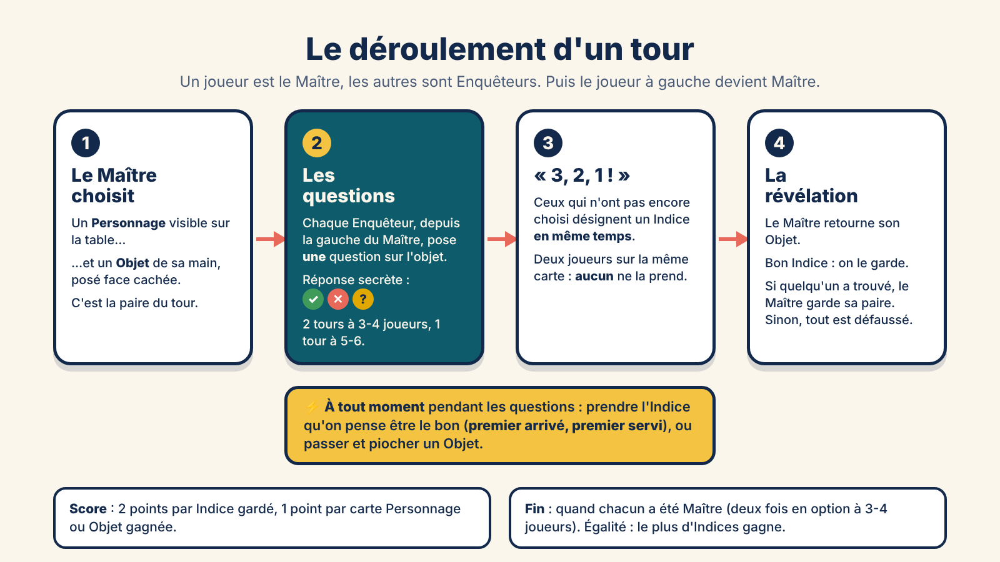
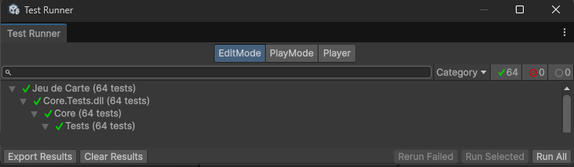
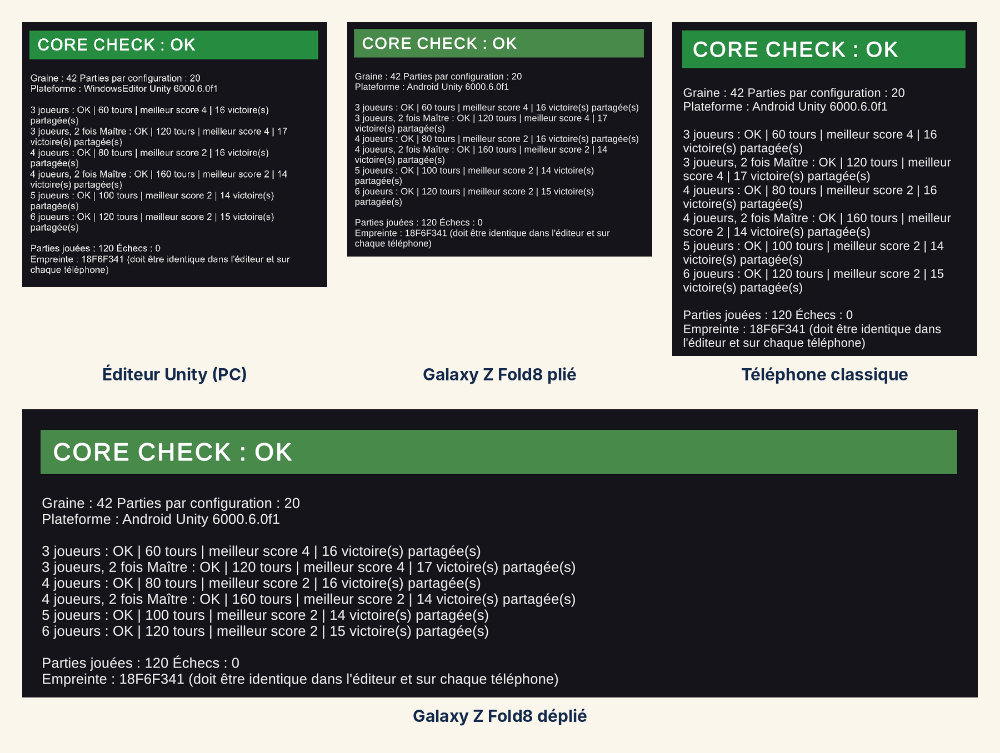

*Devlog du projet [Jeu de Carte (titre provisoire)](/blog_post/unity/Jeu_De_Carte.html).*

Troisième jalon, et cette fois on touche au cœur : **le moteur de règles**. C'est la partie du jeu qui sait tout ce qui se passe sur la table (qui est le Maître, quelles cartes sont où, qui a trouvé, qui a gagné) et qui refuse tout ce que la notice interdit.

Toujours aucune carte à l'écran : le moteur n'a pas d'interface, et c'est voulu. Mais c'est aussi le premier jalon où j'ai écrit des **tests automatiques**, et c'est sans doute ce que je retiendrai le plus de ces deux jours.

---

## 1. Les règles, un peu plus en détail

Dans la présentation du projet, je n'avais donné que le principe. Voici le déroulement complet d'un tour, tel que le moteur l'applique :

**La mise en place.** Quatre cartes Personnage sont retournées face visible, chaque joueur reçoit trois cartes Objet en main, et toutes les cartes Indice sont étalées face visible au milieu.

**Le tour.** Le Maître choisit un Personnage sur la table et un Objet de sa main, posé face cachée. Les Enquêteurs posent chacun une question à leur tour, en partant de la gauche du Maître, et reçoivent en secret une réponse OUI, NON ou ?. À tout moment, un Enquêteur peut prendre l'Indice qu'il pense être le bon (premier arrivé, premier servi), ou passer et piocher un Objet. Après la dernière question, ceux qui n'ont pas encore choisi désignent un Indice **en même temps**.

**La révélation et le score.** Les bons Indices sont gardés (2 points chacun). Si au moins un Enquêteur a trouvé, le Maître garde sa paire (1 point par carte). Sinon, tout est défaussé. Puis le joueur à gauche devient le Maître. La partie s'arrête quand chacun a été Maître une fois (ou deux, en option, à 3 ou 4 joueurs).

---

## 2. Un moteur qui ne connaît pas Unity

Le moteur est écrit en C# « pur » : il n'utilise rien d'Unity. Il ne sait pas ce qu'est une image, un bouton ou un écran. Il reçoit des actions (« ce joueur pose cette question », « ce joueur prend cet Indice ») et il fait évoluer l'état de la partie.

Il avance par **phases** : mise en place, choix du Maître, questions, choix final, révélation, fin de partie. Dans chaque phase, il sait exactement ce qui est permis. Si une action arrive au mauvais moment (un Enquêteur qui pose une question alors que ce n'est pas son tour, un Indice déjà pris), le moteur la **refuse** avec un message clair, au lieu de laisser la partie dans un état bancal.

Ce découpage, c'est ce qui permettra au Jalon 4 de brancher des IA, puis plus tard des joueurs en ligne : ils enverront tous les mêmes actions au même moteur.

---

## 3. Quand la notice ne dit rien

En traduisant les règles en code, on tombe forcément sur des situations que la notice ne tranche pas. Ma règle : **ne rien modifier de ce qui est écrit, seulement combler les trous**, et noter chaque décision dans le document de design. Quelques exemples :

- **Un Enquêteur qui a déjà choisi** son Indice (ou passé) est sauté pendant les questions : il n'a plus rien à gagner à en poser.
- **Deux Enquêteurs désignent la bonne carte en même temps** : la notice dit que personne ne la prend et que le Maître gagne sa paire. Elle ne dit pas ce que devient la carte Indice. J'ai choisi de la défausser, comme quand personne ne trouve : son Objet est déjà gagné, elle ne pourrait plus servir.
- **Prendre un Indice pendant les questions** : le moteur l'accepte à n'importe quel moment de cette phase, dans l'ordre d'arrivée. C'est aux joueurs (humains ou IA) de choisir leur moment.
- **Plus de cartes Personnage dans la pioche** : on ne complète plus la table, comme la notice le prévoit déjà pour la pioche Objet.

---

## 4. Mes premiers tests automatiques

C'est le premier projet où j'écris des tests. Le principe : à côté du moteur, de petits programmes qui jouent une situation précise et vérifient que le résultat est le bon. Par exemple : « à 4 joueurs, il y a bien deux tours de questions », « si deux joueurs désignent la même carte, aucun ne la prend », « en cas d'égalité, celui qui a le plus d'Indices gagne ».

Chaque étape des règles a été écrite **avec ses tests**, dans l'ordre du tour : la mise en place, le choix du Maître, les questions, la prise d'Indice, le « 3, 2, 1 ! », la révélation, puis le score. Le dernier test joue même **une partie complète**, du début à la fin. À la fin du jalon : **64 tests, tous au vert**.

*Le Test Runner de Unity : 64 tests réussis, 0 échec.*

Le vrai intérêt, c'est le filet de sécurité : à chaque nouvelle règle, je relance **tous** les tests. Si une modification casse une étape d'avant, je le sais en quelques secondes, au lieu de le découvrir au milieu d'une partie trois jalons plus tard.

---

## 5. Le même hasard partout

Un jeu de cartes, c'est du hasard : on mélange les pioches, on tire le premier Maître au sort. Mais un hasard impossible à reproduire, c'est un bug impossible à retrouver. Le moteur utilise donc un **hasard à graine** : avec la même graine (un simple nombre), on obtient exactement les mêmes mélanges, donc exactement la même partie.

J'en ai profité pour faire une **scène de vérification** : elle simule **120 parties** (de 3 à 6 joueurs, avec et sans l'option « 2 fois Maître »), vérifie qu'aucune ne plante, et calcule une **empreinte** : un code qui résume le déroulé de toutes ces parties. Si un seul tour se passait différemment, l'empreinte changerait.

Le test de fin de jalon consistait à lancer cette scène dans l'éditeur, puis en **build Android** sur mes deux téléphones. Le build Android compile le code autrement que l'éditeur, donc c'était la vraie preuve que le moteur se comporte pareil partout :

*120 parties simulées, 0 échec, et la même empreinte (18F6F341) dans l'éditeur, sur le Galaxy Z Fold8 plié et déplié et sur un téléphone classique.*

---

## 6. Petite préparation pour les écrans

Pendant ce jalon, j'ai aussi fixé les **proportions des cartes**, en prévision des visuels et des écrans de jeu : les cartes Personnage et Objet sont en **2:3** (portrait), les cartes Indice et les cartes réponse sont **carrées**. À l'écran, une carte pourra être agrandie ou réduite selon la place disponible, mais **jamais étirée ni rognée**.

---

## 7. Les « ah ouais d'accord » du jalon

**Un test, c'est une règle qu'on n'a plus besoin de vérifier à la main.** Une fois écrite, elle est revérifiée à chaque fois, gratuitement.

**Les trous de la notice se voient en codant.** Autour d'une table, on règle un cas bizarre en dix secondes de discussion. Un moteur, lui, doit savoir quoi faire. Écrire les règles en code est le meilleur moyen de relire une notice.

**Le hasard doit être reproductible.** Avec une graine, un bug qui arrive « une fois sur cent » devient un bug qu'on peut rejouer autant de fois qu'on veut.

---

## 8. Ce que je n'ai pas fait

Pas d'écran de jeu, pas d'IA : le moteur ne fait qu'appliquer les règles, et les parties de la scène de vérification sont simulées automatiquement. Les vraies IA arrivent au prochain jalon, avec une contrainte que je me suis fixée : **elles ne doivent pas être surhumaines**. Plusieurs niveaux de difficulté, et jamais de réaction instantanée, pour qu'un humain ait toujours sa chance.

---

## État à la fin du jalon

Un moteur de règles complet, indépendant d'Unity, qui applique la notice du début à la fin de la partie, avec ses décisions documentées là où la notice se tait. 64 tests au vert, et 120 parties simulées qui donnent exactement le même résultat dans l'éditeur et sur deux vrais téléphones. Prochaine étape : **les IA**.

*Précédent : [Jalon 2 — Des cartes sans thème](/blog_post/unity/jeu_de_carte/Jeu_De_Carte-J2.html)*

*Suite : [Jalon 4 — Des IA qui jouent sans tricher](/blog_post/unity/jeu_de_carte/Jeu_De_Carte-J4.html)*
