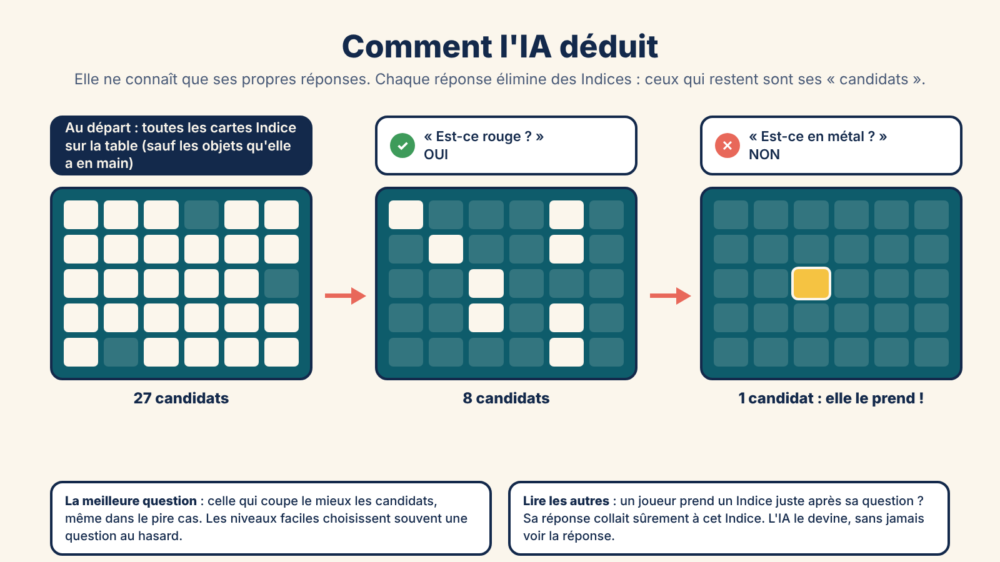
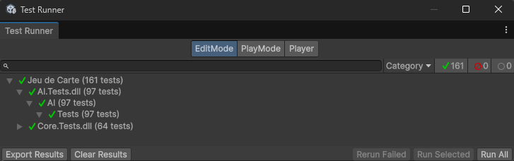
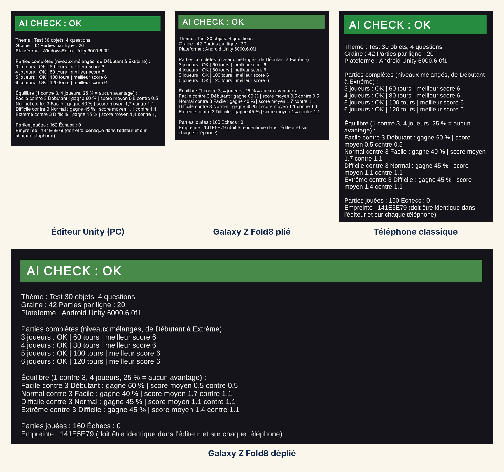

*Devlog du projet [Jeu de Carte (titre provisoire)](/blog_post/unity/Jeu_De_Carte.html).*

Quatrième jalon : **les IA**. Le jeu se joue de 3 à 6 joueurs, et la première version sera en solo. Il me faut donc des adversaires capables de jouer tous les rôles : poser de bonnes questions, prendre un Indice au bon moment, et faire le Maître.

Comme le moteur de règles, l'IA est écrite en C# pur, sans rien d'Unity. Et elle a une contrainte que je me suis imposée dès le départ : **jouer comme un humain, sans tricher, et sans réflexes surhumains**.

---

## 1. La règle d'or : pas de triche

Le moteur, lui, connaît tout : l'objet caché du Maître, la main de chaque joueur, toutes les réponses. L'IA, non. Elle ne voit que ce qu'un joueur assis à la table aurait le droit de voir : les cartes face visible, **ses propres réponses**, et ce que font les autres joueurs.

Ce n'est pas qu'une promesse : l'IA est rangée à part du moteur, et les informations secrètes ne sortent tout simplement pas du moteur. Même si je le voulais, l'IA ne pourrait pas aller les lire.

Et elle passe par **les mêmes actions qu'un joueur humain** : poser une question, répondre, prendre un Indice, passer. Le moteur ne fait aucune différence entre les deux.

---

## 2. Comment elle déduit

Le cœur de l'IA, c'est une idée simple : les **candidats**. Ce sont les cartes Indice encore sur la table qui collent à tout ce qu'elle sait. Au début du tour, presque tout est candidat (sauf les objets qu'elle a en main, puisque le Maître ne peut pas avoir posé l'un d'eux). Chaque réponse en élimine une partie.

**Choisir la question.** Pour chaque question possible, l'IA regarde comment les réponses OUI / NON / ? se répartiraient entre ses candidats, et garde celle qui coupe le mieux, même dans le pire cas. Une question à laquelle tous ses candidats répondent OUI ne lui apprendrait rien.

**Lire les autres.** C'est une astuce donnée par la notice elle-même : quand un joueur prend un Indice juste après la réponse à sa question, sa réponse collait sûrement à cet Indice. L'IA peut le remarquer et en tirer une information. Elle ne voit jamais la réponse, elle la devine, donc elle peut aussi se tromper.

**Prendre un Indice.** Premier arrivé, premier servi. Avec un seul candidat, l'IA est sûre d'elle et le prend. Avec deux, c'est une chance sur deux : selon son niveau, elle attend une question de plus ou tente sa chance pour passer avant les autres. Avec plus de candidats, elle attend.

**Faire le Maître.** Le Maître ne marque des points que si quelqu'un trouve son objet. Il a donc intérêt à être deviné ! L'IA Maître cherche dans sa main l'objet le plus facile à reconnaître : celui qui a le moins de « sosies » sur la table, c'est-à-dire d'Indices qui répondent exactement pareil à toutes les questions. Et elle répond toujours juste.

---

## 3. Cinq niveaux, de Débutant à Extrême

Un seul réglage ne suffit pas à faire une progression crédible. Chaque niveau joue sur plusieurs curseurs à la fois :

| | Débutant | Facile | Normal | Difficile | Extrême |
|---|---|---|---|---|---|
| **Temps de réaction** | 3 à 5 s | 2 à 3,5 s | 1,5 à 3 s | 0,8 à 2 s | 0,5 à 1 s |
| **Mémoire** | la dernière info | les 2 dernières | les 4 dernières | tout | tout |
| **Choisit la meilleure question** | jamais | 1 fois sur 2 | 3 fois sur 4 | 9 fois sur 10 | toujours |
| **Lit les autres joueurs** | jamais | jamais | 1 fois sur 2 | 9 fois sur 10 | toujours |
| **Risque d'erreur** | 20 % | 8 % | 4 % | 2 % | 0 % |

Le **risque d'erreur**, c'est la part d'humain : de temps en temps, l'IA joue un coup permis par les règles mais pas réfléchi (une question inutile, un Indice pris au hasard). Le niveau **Extrême**, lui, est parfait avec tout ce qu'un joueur a le droit de savoir : seuls ses réflexes restent humains. C'est surtout un niveau de test, et je déciderai plus tard s'il apparaîtra dans le menu.

---

## 4. Jamais plus rapide qu'un humain

Dans un jeu où le premier arrivé est le premier servi, une IA qui réagit en un millième de seconde gagnerait tout. J'ai donc ajouté une **table** qui fait jouer les IA : avant chaque action, l'IA attend un délai tiré au hasard dans la fourchette de son niveau. Et quel que soit le niveau, **jamais moins de 0,5 seconde**, pour qu'un humain ait toujours sa chance de prendre un Indice avant elle.

---

## 5. 97 tests de plus

Comme au jalon précédent, chaque morceau de l'IA a été écrit avec ses tests : la mémoire, le calcul des candidats, le choix de la question, les décisions du Maître et de l'Enquêteur, la lecture des autres, les niveaux, puis la table. **97 tests de plus, 161 au total**, tous au vert.

*Le Test Runner : 97 tests pour l'IA, 64 pour le moteur de règles, 161 réussis, 0 échec.*

---

## 6. Des parties 100 % IA, sur tous les écrans

Pour vérifier l'ensemble, une nouvelle scène de vérification fait jouer **des parties entières uniquement entre IA**, sur le thème de test. Comme au Jalon 3, elle calcule une **empreinte** qui résume toutes ces parties : si une seule décision d'une seule IA changeait, l'empreinte changerait.

Résultat : 160 parties, 0 échec, et la **même empreinte (141E5E79)** dans l'éditeur, sur le Galaxy Z Fold8 plié et déplié et sur un téléphone classique.

*Les mêmes 160 parties entre IA, avec exactement le même résultat dans l'éditeur, sur le Fold8 plié et déplié et sur un téléphone classique. Le bloc « Équilibre » est détaillé juste en dessous.*

---

## 7. Une première mesure d'équilibrage

La même scène sert aussi à mesurer les niveaux : une IA joue contre trois IA du niveau juste en dessous, sur 20 parties. Sans aucun avantage, elle gagnerait une partie sur quatre (25 %). Résultat :

| Match | Victoires de l'IA seule |
|---|---|
| Facile contre 3 Débutant | 60 % |
| Normal contre 3 Facile | 40 % |
| Difficile contre 3 Normal | 45 % |
| Extrême contre 3 Difficile | 45 % |

Le niveau au-dessus gagne toujours plus souvent que le hasard, donc **l'ordre des niveaux est bon**. Mais les écarts restent faibles, et je sais pourquoi : le thème de test n'a que **4 questions**. Elles ne permettent de distinguer que 16 combinaisons de réponses pour 30 objets, donc même une IA parfaite hésite souvent entre plusieurs cartes. Je ne retouche pas les réglages pour l'instant : l'équilibrage sera refait avec un vrai thème complet, qui aura assez de questions.

---

## 8. En passant : le multijoueur et la nouvelle feuille de route

Pendant ce jalon, j'ai aussi posé noir sur blanc **les règles du futur multijoueur en ligne** : de 3 à 6 joueurs comme sur table, humains et IA mélangés (les IA complètent la table s'il manque des joueurs), et **Android et PC ensemble dans la même partie**. Pour le réseau, l'idée est d'utiliser les services en ligne d'Epic Games, avec un des joueurs qui héberge la partie : pas de serveur à payer. C'est pour beaucoup plus tard, mais l'architecture prévue depuis le Jalon 1 rend ça possible : le moteur ne fait aucune différence entre un joueur humain, une IA ou un joueur distant.

J'en ai profité pour **redécouper la suite du projet** en jalons plus petits : les écrans de jeu, une partie complète, un thème de test complet, les extensions, un premier vrai thème (fantasy), le game feel, les finitions, et enfin le multijoueur. La feuille de route à jour est dans la [présentation du projet](/blog_post/unity/Jeu_De_Carte.html#5-la-feuille-de-route).

---

## 9. Les « ah ouais d'accord » du jalon

**Une bonne IA de jeu n'est pas une IA parfaite.** Le plus dur n'était pas de la rendre forte, mais de la rendre humaine : lente quand il faut, distraite parfois, et toujours battable.

**La difficulté, c'est plusieurs curseurs.** Jouer seulement sur la vitesse ou seulement sur les erreurs donne des niveaux qui sonnent faux. En les combinant, chaque niveau a sa personnalité.

**Mesurer avant de régler.** Les parties 100 % IA m'ont montré que le problème d'équilibrage venait du thème de test, pas des IA. Sans mesure, j'aurais retouché les mauvais réglages.

---

## État à la fin du jalon

Des IA en C# pur qui jouent tous les rôles avec les mêmes actions qu'un humain, sans jamais tricher, avec 5 niveaux et un temps de réaction toujours humain. 161 tests au vert, des parties 100 % IA identiques dans l'éditeur et sur deux vrais téléphones, et une première mesure d'équilibrage. Prochaine étape : **les écrans de jeu**, pour enfin voir les cartes sur la table.

*Précédent : [Jalon 3 — Le moteur de règles, et mes premiers tests](/blog_post/unity/jeu_de_carte/Jeu_De_Carte-J3.html)*
